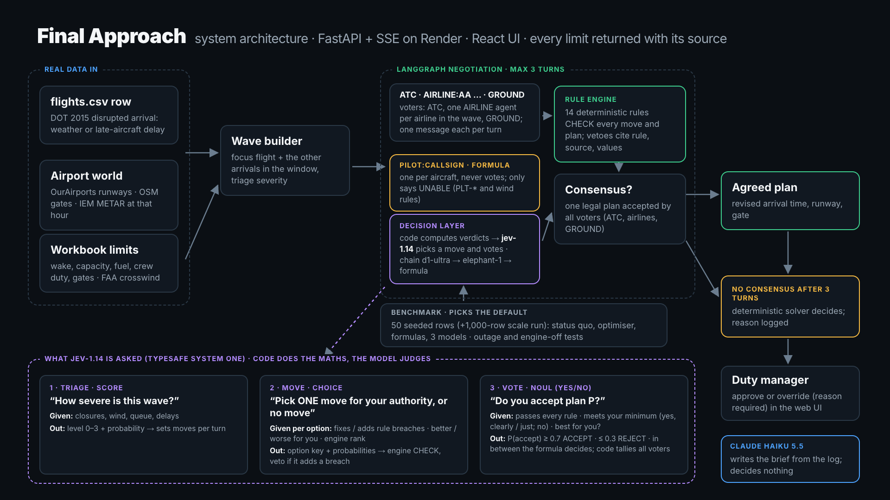
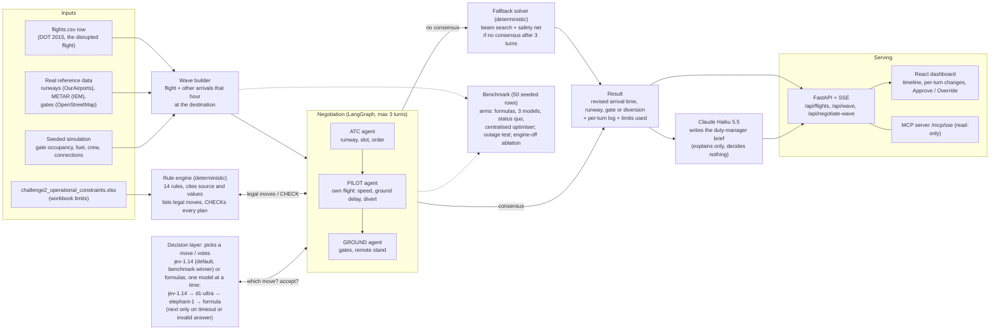
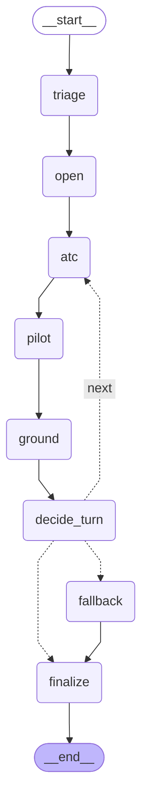
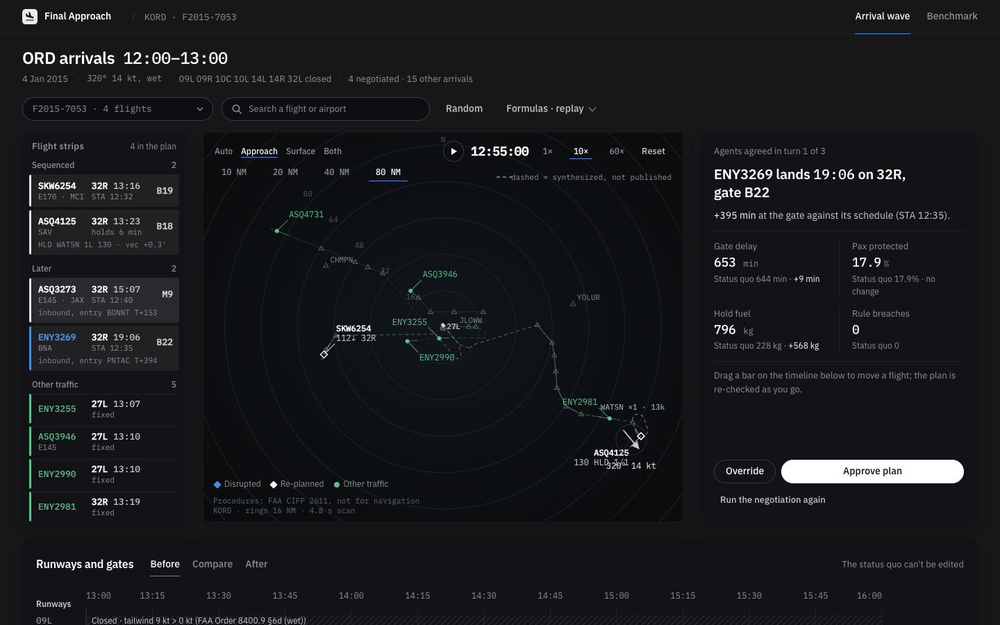
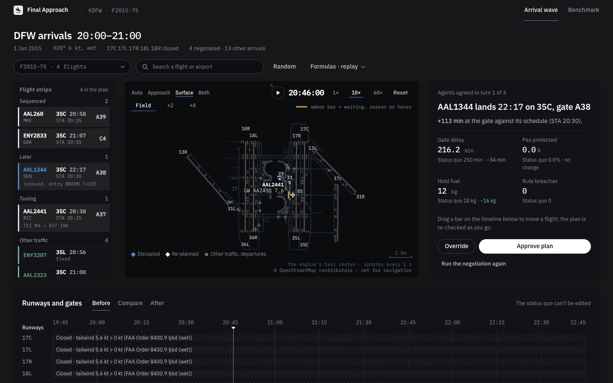

# Final Approach: disruption negotiation for arrival waves (Autonomous SG 2026, Airbus Challenge 2)

Design: `docs/superpowers/specs/2026-10-31-disruption-negotiator-design.md` · API contract: `docs/api-contract.md`

**Live demo:** https://disruption-negotiator.onrender.com · **Deck (36 s):** [YouTube](https://youtu.be/JpgnufOeDQQ) · [MP4](deck/final-approach-deck.mp4)

[](https://youtu.be/JpgnufOeDQQ)



## 1. Pitch

When weather or a late inbound disrupts an arrival, the airline duty manager coordinates by phone between the tower, the crew and ground handling. This prototype replaces those calls with exactly three agents: ATC, PILOT (for the focus flight) and GROUND. The input is one real disrupted flight, a row of `data/challenge2/flights.csv` (DOT 2015, `WEATHER_DELAY > 15` or `LATE_AIRCRAFT_DELAY > 20`). The wave is built at its destination airport, with the other `flights.csv` arrivals in the same window as context and weather fetched on demand from IEM (cited). Each agent sees only its own domain and can only make moves inside its own authority. A deterministic rule engine decides whether any move or plan is legal; no model ever does. Decision models choose among the options the engine offers and vote. Claude (Haiku 5.5) only narrates the finished outcome for the duty manager and decides nothing; every run from the UI gets a brief, with a deterministic template if Claude is unavailable. In the default mode (formulas, chosen by the benchmark) no model takes any decision; decision models run in `decision` and `decision+claude` modes. The output is a revised arrival (time, runway, gate, action, delay vs schedule) plus the full log, and the human approves or overrides. BTS Jun-Aug 2024 waves are still supported as a second source.

## 2. Live demo and local run

Live: https://disruption-negotiator.onrender.com

Render free tier: it sleeps when idle, so expect a cold start of about 1 minute.

Local:

```bash
pip install -r requirements.txt
uvicorn backend.server:app --port 8000        # API, MCP and (if built) the dashboard at http://localhost:8000
```

Frontend build (served at `/` from `frontend/dist` when present; without it the API still runs):

```bash
cd frontend && npm ci && npm run build
```

Docker (multi-stage: builds the frontend, then the Python API; listens on 7860):

```bash
docker build -t disruption-negotiator .
docker run -p 7860:7860 disruption-negotiator
```

Keys are optional and live in `.env` (gitignored): `OPENROUTER_API_KEY`, `TYPESAFE_API_KEY`, `ANTHROPIC_API_KEY`. With none set, negotiation runs on the local formulas and narration uses a deterministic template. The Docker image sets `ATM_REQUIRE_REAL=1`.

## 3. Architecture

Input: pick a flight with `GET /api/flights`, id `F2015-<row_id>` (BTS 2024 wave ids still work).

### System



### Negotiation graph (exported from LangGraph)



Protocol (`backend/wave/graph.py`, LangGraph). Per turn each agent (ATC, then PILOT, then GROUND) sends ONE `AGENT_TURN` message holding its moves, the moves the engine rejected with their violations, its proposal, its votes and a rationale. The engine runs a `CHECK` after every proposal. Consensus means all 3 agents `ACCEPT` the same plan that passed `CHECK`, within a turn. After at most 3 turns without consensus, a deterministic beam solver with a safety net produces the plan and the reason is logged.

Components (all under `backend/`):

- **Wave builder** (`wave/flights2015.py`, `wave/build.py`): builds the wave from a `flights.csv` row (or a BTS 2024 wave), real runways, METAR, FAA registry and OSM gates, plus seeded simulation of what no public source has. Deterministic per id.
- **Workbook limits** (`wave/constraints.py`): airport capacity, wake table, fuel and crew rules parsed from `data/challenge2/challenge2_operational_constraints.xlsx` (sheet `rules_of_play`), with hard-coded fallbacks equal to the workbook.
- **Rules engine** (`wave/rules.py`): every check is a formula, and every result cites rule, source and input values. Fourteen rules:
  - `ATC-RWY-OPEN`: runway exists and is open.
  - `ATC-WAKE-SEP`: workbook wake distance (3-8 nm) between leader and follower on the same physical runway, converted to time at 140 kt (x1.25 when wet or low visibility).
  - `ATC-RWY-CAPACITY`: arrivals per runway per rolling 60 min within the workbook cap.
  - `ATC-TAXI-ROUTE`: taxi route to the gate is usable.
  - `ATC-TAXI-CONFLICT`: the landing taxis to its stand against the fixed 2015 ground traffic and earlier wave flights (hold-short / give-way waits within the 30-min horizon) and has vacated its runway before the next landing or takeoff on it. Waits cost in-block time, they never fail it.
  - `ATC-HOLD-STACK`: at most 5 simultaneous holders per physical hold fix, 1,000 ft apart, bottom-first exit (a later entrant may not leave while an earlier one still holds).
  - `ATC-WIND-LIMITS`: crosswind and tailwind from real METAR against FAA Order 8400.9 section 6d and demonstrated crosswind by type.
  - `PLT-EARLIEST-ETA`: no landing before the flight can physically arrive.
  - `PLT-FUEL-RESERVE`: hold fits within extra fuel above alternate plus 30 min final reserve.
  - `PLT-CREW-DUTY`: in-block (or alternate arrival) within 13 h of crew report time; report = scheduled departure - 60 min. A bust that even the earliest landing cannot avoid is reported, not vetoed.
  - `GND-GATE-SIZE`: gate fits the aircraft.
  - `GND-GATE-FREE`: gate not occupied, including by other wave flights, with the airport turnaround time.
  - `GND-GATE-NOTICE`: gate changes need at least 20 min notice.
  - `GND-CREW-DUTY`: reports ground overtime past the 8 h shift. It never vetoes; overtime is a cost.
- **Moves and authority** (`wave/moves.py`): ATC changes runway, slot and order. PILOT changes only its own flight (speed reduction, ground delay, divert, accept). GROUND changes gates only.
- **Utilities** (`wave/utility.py`): ATC scores the wave, PILOT its own flight, GROUND gates and crew (overtime at 1.5x). Voting uses a reservation schedule that drops each turn.
- **Safety**: every move and every proposal is engine-checked, votes are cast only on `CHECK`-passed plans, the final plan's feasibility is re-checked, and models only choose among offered options.
- **Decision layer** (`decide.py`): per call, a chain of OpenRouter models, then TypeSafe (Jev), then local formulas. Each call has a 2 s timeout and one retry on 429/5xx. A circuit breaker skips an entry for 60 s after 3 consecutive failures. Every fallback is logged and shown in the UI.
- **Fallback solver** (`wave/fallback.py`): beam search over legal moves maximising the worst agent's utility, with a remote-stand, ground-delay or divert safety net. Legality is still decided only by the rules engine. It never raises.
- **Narration** (`wave/narrate.py`): Claude writes the brief from the structured outcome; deterministic template on any failure.
- **API and SSE** (`server.py`): REST under `/api` (`/api/flights`, `/api/waves`, `/api/wave/{id}`, `/api/runs/{id}`, `/api/benchmark`, `/api/config`) and `POST /api/negotiate-wave`, which streams messages as server-sent events. Output is `result.revision` plus the full log. Contract v2.0 is `docs/api-contract.md`.
- **MCP server** (`mcp_server.py`): read-only, at `/mcp/sse`. Six tools: `list_waves`, `get_wave`, `fcfs_plan`, `legal_moves`, `check_plan`, `negotiate` (formulas only).

### Limits applied (`rules.LIMITS`, `rules.limits_for`)

Every change and assumption is returned in `result.limits`. Summary:

| Limit | What we do | Source |
|---|---|---|
| Wake separation | Workbook distances (`min_separation_nm`, 3-8 nm) converted to time at a 140 kt approach speed (3 nm = 77 s, 5 nm = 129 s, 8 nm = 206 s); same physical runway | workbook (nm column); 140 kt is an assumption |
| Wet or low-visibility factor | x1.25 on wake times | assumption |
| B757 | Treated as Heavy | assumption |
| Runways and wind | Real runways and METAR instead of the workbook runway count (used only as the capacity divisor) | real data |
| Runway capacity | `max_runway_ops_per_hour / active_runways` per runway; counts arrivals only | workbook, arrivals only |
| Turnaround, gates, spare gates | Per airport from workbook (turnaround 45/35 min, spare gates); wave models `min(gates, 12)` gates plus a remote stand with 2 positions | workbook; remote stand is an assumption |
| Fuel burn, reserve, spare | 2400 / 6500 kg/h, 30 min final reserve, 45 min spare fuel | workbook |
| Contingency fuel 5% | Not credited: it covers en-route deviations, and the workbook's 45 min spare-on-arrival is what is checked at the destination. Not crediting it is the conservative reading | assumption |
| Flight crew 13 h duty | Enforced by `PLT-CREW-DUTY`; report time = scheduled departure - 60 min | workbook; report offset is an assumption |
| Ground shift | 8 h, overtime at 1.5x is a cost, not illegal | workbook |
| Gate change notice | At least 20 min; remote stand exempt | workbook |
| Speed reduction | Capped at 8 min | assumption |
| Taxi-in time (engine `v3-taxi`) | In-block = landing slot + runway occupancy time (roll to the first forward exit past the required roll) + unimpeded taxi on the OpenStreetMap taxiway graph from that exit to the gate's stand (gates bound to OSM stands; 20 kt, 10 kt on taxilanes and turns > 30°, + 30 s to park). Tiers: real (OSM route); generic (runway end missing from today's OSM, a wave below the 80 % surface quality gate, or an unbound gate: straight line runway midpoint to gate x1.4 at 15 kt); no geometry (no runway coordinates: 6 min near / 10 min far). Remote stand + 10 min bus; no taxiway closures. The time is unimpeded: no ramp, gate or queue waits until `ATC-TAXI-CONFLICT` schedules hold-shorts, so it sits below BTS `TAXI_IN`. Validation without fitting (benchmark focus flights on the real surface tier with a real `TAXI_IN`, ROT + routed taxi vs `TAXI_IN`): n 42, MAE 3.37 min, bias -2.78 min, per-airport table in `eval/BENCHMARK.md` (Taxi-in validation). Figures quoted here earlier were FCFS medians over all flights of the replay waves, not this validation | real data (OSM, ODbL); speeds, generic tier and 6/10 min fallback are assumptions |
| Time base (engine `v3-time`) | BTS scheduled arrival (STA) is a gate (in-block) time. Earliest landing = STA + attributed BTS delays (late aircraft, carrier, weather, NAS) - taxi-in reference (the row's real `TAXI_IN`, else the airport's 2015 median over the challenge's delayed-flight rows, else 6 min). For a 2015 row that is the real wheels-on whenever the attributed delays sum to `ARRIVAL_DELAY` (security delay is not attributed). Delay = max(0, in-block - STA), also for `delay_vs_schedule_min`. Fixed-traffic arrivals land at their real wheels-on (STA + `ARRIVAL_DELAY` - `TAXI_IN`) but are still picked by scheduled time, so a late one can land hours after the window. Crew floors and `PLT-CREW-DUTY`'s "unavoidable" test use ROT + unimpeded routed taxi to the gate, minimised over the open runways. In-block uses that unimpeded routed taxi (see Taxi-in time), so the FCFS delay of a flight sits below its real BTS delay by (taxi-in reference - ROT - unimpeded taxi) when that is positive | real data (BTS `ARRIVAL_DELAY`, `WHEELS_ON`, `TAXI_IN`); 6 min fallback is an assumption |

### Flight paths and the airport surface (engine `v3-traffic`)

The plan is no longer only a table of slots. Every landing now has a flown path, and the same plan drives the radar and the surface map on one replay clock.

- **Air.** Each flight flies a published route: the FAA CIFP 2611 STAR and approach (or a synthetic corner-post and downwind route where the airport has none, drawn dashed), at the terminal speed profile. Flights that lap enter a holding stack (1,000 ft levels, bottom-first exit) at the hold fix of its STAR (the first fix of the common route, else the last enroute-transition fix). The slot, the fuel burned in the hold and the lap count all come from that same path, so the radar draws what the engine used and nothing else.
- **Ground.** After touchdown the flight rolls to the first forward exit past the required roll and taxis the fastest route on the OpenStreetMap taxiway graph to its bound stand. The real 2015 movements of the same hour (queue arrivals and departures) are scheduled once as fixed traffic, and each wave flight waits at a node or a runway hold until the headway, crossing gap and runway-vacate rules are met. Those waits are the amber bars on the surface map and they add to in-block time.
- **Legality stays in the rule engine.** `ATC-HOLD-STACK` and `ATC-TAXI-CONFLICT` are deterministic rules like the other twelve (14 in all); no model decides whether a path is legal. Every point and segment carries `src: "cifp" | "osm" | "synth"` and synthesized parts are drawn dashed.
- **Offline.** Procedures, surface and movements are derived files in `data/ref/` (and seeded into Postgres); the runtime never fetches CIFP, OSM or BTS.

Screenshots (replay mode, no keys): the status-quo plan of `F2015-7053` with ASQ4125 (EV4125) in its hold at WATSN, and `F2015-75` at DFW with AAL2441 waiting to give way to AA2498.





## 4. Data and provenance

| Layer | Source | Status |
|---|---|---|
| Focus flight, delays, context arrivals | DOT 2015 `flights.csv` (challenge file) | real |
| Second source: flights, delays, queue | BTS On-Time, Jun-Aug 2024, arrivals to 30 hubs | real |
| Runways (ends, headings, length) | OurAirports | real |
| Weather at arrival hour (wind, visibility, ceiling, wet/dry) | Iowa Environmental Mesonet METAR archive, fetched on demand and cited | real |
| Airport capacity, turnaround, wake table, fuel and crew rules | challenge workbook (synthetic planning numbers) | given by the challenge |
| Tail to aircraft type, wake category, gate size | FAA aircraft registry | real (US-registered tails) |
| Gates and wide-body gates | OpenStreetMap, 10 hubs | real |
| Arrival procedures (STARs, approaches, hold fixes) | FAA CIFP, cycle 2611, pinned (`scripts/fetch_cifp.py`) | real; **Procedures: FAA CIFP 2611, not for navigation** |
| Airport surface (taxiways, runways, stands, holding positions) | OpenStreetMap via Overpass (`scripts/fetch_surface.py`), ODbL | real; **© OpenStreetMap contributors**, not for navigation |
| Real ground traffic of the wave hour (arrivals, departures, taxi times) | BTS On-Time 2015 (`flights.csv` movements, `data/ref/movements2015`) | real |
| Gate occupancy | seeded simulation | simulated, badged |
| Fuel on board | seeded simulation | simulated, badged |
| Crew shifts | seeded simulation, anchored to the flight's actual delayed ETA | simulated, badged |
| Passenger connections | seeded simulation | simulated, badged |
| Two wide gates per hub where OSM has none | simulated | simulated, badged |

Layers missing for a flight fall back to a generic model and are badged in the UI. Procedures: FAA CIFP 2611, not for navigation. The derived procedure and surface files are for this simulation only and are not for navigation. Map data © OpenStreetMap contributors (ODbL).

### Data: Postgres (Neon) with file fallback

Reference data, runs and decisions live in Neon Postgres. The files under `data/` stay in the repo and are the fallback: the app serves from them when no database is configured or the database is down.

| Variable | Used by | Meaning |
|---|---|---|
| `DATABASE_URL_POOLED` | app runtime (`PgStore` pool), Render, `scripts/db_timings.py` | Neon pooled (`-pooler`) endpoint, `sslmode=require`. The only database secret on Render. Unset: the app uses files. |
| `DATABASE_URL` | `scripts/db_migrate.py`, `scripts/db_seed.py`, `scripts/db_dump_live.py` | Neon direct endpoint, owner role. Dev machine only; never put it on Render. |
| `DATABASE_TEST_URL` | live DB tests | Direct owner URL of a separate `atm_test` database in the same Neon project. |
| `ATM_STORE` | app | `files` forces the file store; `pg` requires `DATABASE_URL_POOLED`. |
| `ATM_LIVE_DB` | tests | `1` enables the opt-in live tests. |
| `ATM_WARM` | app | Default `1`: a one-shot daemon thread loads the flights.csv index and builds the replay (demo) waves so the first page load is fast (started at boot with the file store, else by the first request, normally Render's `/api/config` health check). `0` turns it off (the test suite sets it). |
| `ATM_PLAN_CACHE` | app | Default `256`: plans whose 4D trajectories are kept in memory (about 125-170 KB each, so about 43 MB at most). Edit suggestion searches never add to it. The offline benchmark raises it to 256 per worker thread. |

Neon setup: project in region `aws-us-west-2` (Oregon, next to Render's default `oregon`; a region cannot be changed later). Fix the compute at 0.25 CU (min = max) in the Console; autoscaling would burn the free 100 CU-hours up to 8 times faster. Keep a `test` branch (or the `atm_test` database) for the live tests so they never touch the production data.

```bash
python3 scripts/db_migrate.py            # apply migrations/NNNN_*.sql as the owner (append-only, checksummed)
python3 scripts/db_seed.py               # load the reference data (idempotent, shadow-table swap, 750 MB guard)
python3 scripts/db_seed.py --check       # verify row counts and checksums against the files
ATM_LIVE_DB=1 python3 -m pytest -q -m live_db   # optional: live tests against DATABASE_TEST_URL
python3 scripts/db_dump_live.py          # back up live.runs and live.decisions to .cache/dump/*.jsonl
python3 scripts/db_timings.py            # p50/p95 per path against the design budgets (add --after-idle for a wake-up sample)
```

First production seed, in order:

1. `python3 scripts/db_migrate.py`
2. `python3 scripts/db_seed.py`. Careful: the default dataset list includes `runs_import`, which loads every run in your local `eval/runs/` folder into the production `live.runs`. Review or clean that folder first, or name the datasets explicitly and leave `runs_import` out (`python3 scripts/db_seed.py small workbook waves bts_arrivals metar_2024 iem_cache flights2015 disruptions_v1 replays benchmark v1_eval procedures surface movements2015`).
3. `python3 scripts/db_seed.py --check` (must report no mismatches)
4. In the Render dashboard set `DATABASE_URL_POOLED` (the pooler URL). Never set `DATABASE_URL` there.
5. Redeploy.
6. Run one negotiation and approve it; note the run id.
7. Redeploy again.
8. Confirm `GET /api/runs/<id>` still returns that run, and `GET /api/config` shows `"backend": "postgres"` and `"degraded": false`.
9. `python3 scripts/db_timings.py` from the dev machine.

Rollback: unset `DATABASE_URL_POOLED` in the Render dashboard and redeploy. The app is back on files (runs saved while it was on Postgres stay in the database; `scripts/db_dump_live.py` exports them).

`DATABASE_TEST_URL` is a separate `atm_test` database in the same Neon project (a Neon `test` branch also works); the live tests never touch the production database.

Measured sizes (1 GB free limit): `atm_test` with all reference data 152 MB; the raw datasets add an estimated ~158 MB (they load only when named). When the build is finished, free that space: from the owner connection to the production database (`DATABASE_URL`), run `drop database atm_test;`.

Statement timeout: migration `0006` sets `statement_timeout = '5s'` on the role that runs it (the owner, which `DATABASE_URL_POOLED` uses for now), in that database only, so a runaway query from the app is cancelled after 5 s. It is a role setting because `SET` does not survive the pooler. `db_seed.py`, `db_migrate.py` and `db_dump_live.py` lift it to 0 on their own connections so long loads and exports finish. The limit also applies to your own sessions as the owner (Neon SQL editor, psql): run `set statement_timeout = 0;` first for manual maintenance. Apply `0006` to `atm_test` too (`python3 scripts/db_migrate.py --url-env DATABASE_TEST_URL`).

Fallback behaviour: every read and write goes through `FallbackStore`. A failed or timed-out call is retried (except `record_decision` and `put_benchmark`, which are not idempotent), then served from files; three consecutive failures open a breaker for 60 s. `GET /api/config` never queries the database. Read its `store` object: `"backend": "postgres"` with `"degraded": false` is healthy. `"backend": "files"` with `"degraded": true` (and a `reason`) is the fallback: a database is configured but unreachable, and runs saved then are not persistent. `"backend": "files"` with `"degraded": false` means no database is configured. A write the database rejects (a constraint, bad data, a missing table or privilege) is kept in the files and shows as degraded, without opening the breaker; an empty (unseeded) table is served from files the same way.

What changed in the v3 build:

- **`raw.*` only when named.** The raw challenge tables (about 120 MB, never read by the app) are no longer in the default dataset list: `python3 scripts/db_seed.py raw` loads them, `--drop raw` removes them.
- **`replays` prunes.** Seeding `replays` deletes the `eval.replays` rows whose `(wave_id, engine_version)` is not in `data/replay/`, so only the recorded files stay.
- **Geometry is documents, not points.** The app reads one gzipped document per airport from `geo.procedures` and `geo.surface` (and `geo.movements2015_day` for the fixed traffic), seeded by the `procedures`, `surface` and `movements2015` datasets. Migration `0007` dropped the point tables (`geo.fixes`, `geo.stands`, `geo.osm_gates`, `geo.holding_positions`), `geo.coverage` and the PostGIS extension; nothing queries by location. The coverage report is the file `data/ref/GEO_COVERAGE.md` (`scripts/geo_coverage.py`).

Compute hours: the free plan gives 100 CU-hours a month, which is 400 active hours at 0.25 CU. Compute suspends 5 minutes after the last query. Do not add a keep-alive, a timer query or a database call to the health check: a database that is never idle uses about 183 CU-hours a month and the budget is gone in about 16 days. If the budget runs out, the site keeps running on files (degraded).

Optional, later: a least-privilege login for the runtime. Until then `DATABASE_URL_POOLED` uses the owner role and nothing depends on `atm_app`. Run this once as the owner (the Neon SQL editor or `psql`), choosing the password yourself:

```sql
create role atm_app login password '<password>' in role app_read, app_write;
alter role atm_app set statement_timeout = '5s';
alter role atm_app set search_path = ref, live, eval, geo, extensions;
```

The `statement_timeout` line gives `atm_app` the same 5 s limit that `0006` gives the owner (`0006` only covers the role that ran it). `atm_app` needs both groups: `app_write` alone has no `SELECT`, which `UPDATE ... WHERE` and `ON CONFLICT` need. Then point `DATABASE_URL_POOLED` (in `.env` and Render) at the pooler URL for `atm_app`.

## 5. Evaluation

**What the measured impact is:** every final plan obeys every rule (0 violations in every arm), while the uncoordinated status quo breaks at least one rule on 16 of 50 waves; with the rule engine switched off, 32% of the agents' plans are illegal; a negotiation takes about 1 s in formulas mode and 4-8 s with jev-1.14 (`stats.elapsed_ms`). Delay is roughly neutral: on the 34 waves where the status quo is legal, the negotiated plans are about 2 min better in total. Negotiation buys legality first; minutes are a small bonus.

Method (`python3 -m backend.wave.benchmark --n 50 --arms <models>,formula --concurrency 4 --seed 7`):

- 50 seeded `flights.csv` rows, stratified over the 30 busiest hubs (BTS 2024 waves remain available with `--source bts`).
- Selection rule: best outcome among arms with error < 2%, p95 < 1 s and consensus >= 90%; tie goes to lower Brier.
- Arms: each candidate decision model (full chain behavior, same waves), the formula arm (no model), and the status quo (FCFS slots, scheduled gates, no coordination).
- Metrics:
  - consensus %: waves that reached agreement within 3 turns; fallback % is the rest, ending in the deterministic solver.
  - error rate: % of decisions answered after the arm's model failed (non-empty `fallback_from`).
  - latency p50/p95: over model-answered decisions only.
  - Brier: mean `(p_accept - y)^2` over model-answered votes, where `y` is the formula verdict (utility at or above reservation). It measures agreement with the formula, not with ground truth.
  - agreement with formula: share of decisions matching the formula arm.
  - outcome means (delay, fuel, passengers protected, crew overtime): over waves that succeeded in every arm.
  - status-quo comparison: the status quo may itself break rules, so regressions against it are reported only on waves where the status quo is feasible.
- Outage test: the primary model is replaced by an invalid id and the chain must still resolve every wave.
- Engine-off ablation: the share of formula-arm final plans that are infeasible under the real rules when the rules engine is disabled.

<!-- BENCHMARK -->
Run: `python3 -m backend.wave.benchmark --source flights2015 --n 50 --arms openrouter:typesafe/jev-1.14,openrouter:liquid/d1-ultra,openrouter:baseten/elephant-1,formula --concurrency 4 --seed 7 --outage-n 20` (re-run 2 Nov 2026 after the runway-history fix, live models, final rules). Same 50 flights.csv rows (seeded, stratified over 30 hubs) for every arm; all arms finished all 50.

| Arm | Consensus (raw-number prompts → judgement-only) | Mean turns | Rule violations | Total delay, all wave arrivals (min) [95% CI] | Gap to optimiser (min) | Pax protected | Brier* | p50 / p95 ms | Errors | Same plan as formulas |
|---|---|---|---|---|---|---|---|---|---|---|
| typesafe/jev-1.14 | 94% → **98%** | 1.32 | 0 | 351.2 [305, 398] | 1.6 | 25.8% | 0.0063 | 446 / 598 | 0% | 66% |
| liquid/d1-ultra | 82% → **96%** | 1.36 | 0 | 351.4 [305, 398] | 1.8 | 25.5% | 0.0016 | 568 / 668 | 0% | 84% |
| baseten/elephant-1 | 68% → **98%** | 1.34 | 0 | 351.4 [305, 398] | 1.8 | 25.8% | 0.0155 | 493 / 579 | 0% | 74% |
| formula | 98% | 1.32 | 0 | 351.2 [305, 398] | 1.6 | 25.5% | n/a | n/a / n/a | 0% | 100% |
| centralised optimiser (beam search, no negotiation) | - | - | 0 infeasible | 349.6 [303, 396] | 0 | 26.1% | - | ~2.3 s/wave | - | - |
| status quo (no negotiation) | - | - | breaks a rule on 16/50 waves | 343.2 | - | 26.5% | - | - | - | - |

\* Brier is measured against the formula verdict (accept if utility >= reservation), not ground truth.

- **Code does the maths, the model judges.** Following TypeSafe's System One guidance ("keep deterministic work in code"), the decision models never see raw utilities. Code pre-computes every comparison into words: per move, whether it fixes or adds rule breaches, whether it is better or worse for the agent, and the engine's rank; per vote, whether the plan meets the agent's minimum this turn, with explicit yes/no criteria. The model only makes the final pick and the accept/reject. A model vote counts only when it is confident (TypeSafe confidence routing): P(accept) >= 0.7 accepts, <= 0.3 rejects, and anything in between falls back to the formula verdict, marked `decided_by: formula` in the log. In the recorded jev-1.14 runs no vote landed in that band. The model is offered exactly the moves the formula may take (a Pilot may divert only for its own fuel problem or when every runway is closed).
- **Result: the decision models now match the formulas.** jev-1.14 reaches 98% consensus in 1.32 turns with 351.2 min total delay, 1.6 min from the optimiser (formulas: 351.2, 1.6). With raw numbers in the prompt the same models reached 68-94% consensus and jev-1.14 carried 10 min more delay.
- **Selection: `typesafe/jev-1.14`** by the rule: best outcome among arms with error < 2%, p95 < 1 s and consensus >= 90%; tie -> lower Brier
- **How good is "good"?** The centralised optimiser (the beam-search solver run on each wave with no negotiation) is the reference for what one coordinator would pick. Three self-interested agents negotiating land within about 2 min of it.
- **Status quo:** it breaks at least one rule on 16 of 50 waves. On the 34 waves where it is legal, the negotiated plans are also faster: 336.5 min (formulas) and 336.8 min (jev-1.14) against 338.8 min for the status quo.
- **Safety:** 0 rule violations in any final plan, every arm. **Engine-off ablation:** 32% of the agents' final plans break a rule when the engine is disabled.
- **Outage test:** primary model replaced by a dead endpoint on 20 waves; 20/20 resolved with a legal plan.
- **100 rows with every reference (`eval/BENCHMARK_100.md`):** jev-1.14 reaches 99% consensus in 1.25 turns, 0 rule violations, 342.9 min total delay, 0.9 min from the optimiser (341.9); formulas 342.7, 0.7 min. The status quo breaks a rule on 28 of 100 waves; on the 72 where it is legal, the negotiated plans are faster (336.1 min jev-1.14, 335.7 formulas vs 338.1).
- **At scale (1,000 rows, `eval/BENCHMARK_1000.md`):** jev-1.14 reaches 99.5% consensus in 1.20 turns with 329.8 ± 10.6 min mean total delay, against 329.3 ± 10.6 for the formulas, with the same outcome on 100% of the 999 waves.
- Full report: `eval/BENCHMARK.md`, raw data `eval/benchmark.json`.
<!-- /BENCHMARK -->

### Cost of model calls

Measured on 31 Oct 2026 from the OpenRouter key's usage counter before and after 20 random live flights.csv waves in decision mode (jev-1.14): **191 model calls for $0.0097**, so about **$0.00005 per call and $0.0005 per wave** (9.6 calls per wave: one triage, the move picks and the votes).

| Item | Per wave | Per 1,000 waves | Source |
|---|---|---|---|
| jev-1.14 decisions (OpenRouter) | ~$0.0005 | ~$0.50 | measured, as above |
| Claude Haiku 5.5 brief (one call, max 1,500 output tokens) | at most ~$0.0016 | at most ~$1.60 | Anthropic list price $0.10 / $0.50 per million input / output tokens; upper bound assuming 8k input tokens and the full output cap |
| Formulas mode | $0 | $0 | no model calls |
| **Total, decision mode with brief** | **about $0.002** | **about $2** | |

For scale: everything this key spent during the hackathon, including every benchmark arm, the 1,000-row and 100-row runs and the outage tests, came to about $6. Replays cost nothing (no model calls). The path and surface layers add no model calls either: trajectories, taxi routes and the hold-short schedule are deterministic code, and `GET /api/wave/{id}/geo` and `POST /api/trajectories` are pure computation. The v3 benchmark records no cost (`cost_usd_per_wave` is 0.0, output tokens free, input cost not measured), so the figures above come from the 31 Oct measurement on the v2 call pattern.

### Demo replays

Recorded runs in `data/replay/` (engine v3-traffic, live decision models: `liquid/d1-ultra`, 0 model fallbacks) play back with no model calls. Waves without a recording run live. The "laps" flight is the one that flies the holding pattern on the radar. Delay and fuel are wave totals of the agreed plan against the status quo (first come, first served), from the recordings; taxi waits are the hold-short and give-way waits of ATC-TAXI-CONFLICT against the fixed 2015 ground traffic.
- `F2015-7053` ORD: MQ3269 on 32R, gate B22, +395 min. The status quo is legal but EV4125 laps once (5.7 min, 228 kg). Agreed in round 1: EV4125 moves to 22R and EV3273 to 28R, which removes the hold but costs more on the wave: delay 644.0 → 653.0 min, fuel 228 → 796 kg (the longer routes), pax protected 17.9 % both. No taxi wait for the wave flights, but the fixed 2015 ORD departures are overloaded in this wave (41 of 88 still waiting at the 30-min horizon, takeoffs up to 36 min late; see LIMITS).
- `F2015-292602` MIA: AA943 on 08L, gate A4, +314 min. The status quo fails GND-GATE-FREE (AA1202 and AA1254 on gate A2), so the agreed plan (round 1) is the only legal one of the two, at a cost: delay 505.2 → 540.4 min, fuel 0 → 1,788 kg, pax protected 17.3 → 12.9 %. AA1254 moves to runway 30 and AA1202 laps 9 times (44.7 min) because the plan pushes it from T+73 to T+117.7 min to clear the gate. Taxi waits 1.6 → 0 min.
- `F2015-152758` ATL: DL2256 on 08L, gate T11, +313 min. In the status quo DL1532 and DL1600 each lap once (6.4 and 7.7 min), and it fails GND-GATE-FREE (DL1532, DL1537 and DL1600 on gate E17). Agreed in round 2: the three spread over 09R (gate E16), 08R and 09L (gate E15), which is legal and better: delay 757.4 → 745.9 min, fuel 564 → 160 kg, no lap. DL1532 now waits 1.5 min on its taxi (wave taxi waits 0.4 → 1.5 min).
- `F2015-75` DFW, crosswind runway closures: AA1344 on 35C, gate A38, +113 min. The status quo is legal but slow on the ground: AA260, AA2441 and MQ2833 wait 7.6, 13.6 and 21.0 min head-on against the 36R departure stream on their fixed taxi route (42.2 min in all). The agents move AA2441 and MQ2833 to 35L (round 1), which cuts the taxi waits to 4.0 and 0.8 min (12.4 min in all): delay 250.0 → 216.2 min, fuel 28 → 12 kg. No lap.
- `F2015-77162` DEN: DL927 on 16L, gate C35, +133 min. The status quo fails GND-GATE-FREE (NK853 and WN463 on gate C46), so the agreed plan (round 2) is the only legal one: WN130 moves to runway 07, NK853 to 16R and gate C35, WN463 to 17R. Delay 335.9 → 337.9 min, fuel 0 → 28 kg. No lap, no taxi wait.

Laps: status quo in ORD F2015-7053 and ATL F2015-152758, agreed plan in MIA (gate relief for a non-focus flight; the pattern is analysed in `eval/archive/engine-v3-air/BENCHMARK.md`). DFW shows the taxi waits; DEN clears its gate clash with runway and gate changes, no hold.

Failure case, live (no recording): `F2015-102056` (DL2019). In turns 1-3 no plan on the table passes the engine CHECK, so the log shows three `NO_CONSENSUS` messages and a `FALLBACK` with its reason; the safety net diverts DL2019 to CSG (about 320 min). The system declines to invent a plan it cannot prove legal.

## 6. What went wrong and what we fixed

- **First real-data run: 24 to 52% consensus.** Simulated crew shifts ignored real delays, so about 70% of flights were infeasible before any agent moved. Crew shifts are now anchored to the actual delayed ETA.
- **VRB wind closed every runway.** It is now treated as calm.
- **No wide gates.** OSM had none at many hubs; we add two simulated wide gates where it has none, badged.
- **Divert delay ignored existing delay.** Fixed.
- Formula consensus rose from 47% to 97% on 30 waves.
- **First benchmark: 47 to 74% model error rate.** Concurrency 16 with a 2 s timeout caused timeouts under load; we reran at concurrency 4.
- **Spec update at 12:45.** The challenge now wants 3 agents and turns on `flights.csv` rows, so we moved from N-pilot waves to 3-agent turns.
- **Final review found two bugs.** Weather delay was dropped from the ETA, and pilots diverted just to clear Ground's gate conflict. Both fixed.
- **First `flights.csv` benchmark picked a model that fell back to the solver on 32% of waves.** We added the consensus >= 90% gate to the selection rule.

## 7. Limits

- The workbook limits are synthetic planning numbers, and we relax or assume several of them (table above).
- Gate occupancy, fuel, crew shifts and connections are simulated. Outcome gains depend partly on those assumptions.
- Brier is measured against the formula verdict, not ground truth.
- n = 50 waves; small differences between arms are not significant.
- The delay utility caps at 60 minutes, so flights that are hours late gain little from negotiation.
- The airborne flag ignores time zones (BTS waves); about 8% of flights are misclassified.
- METAR is the latest observation at or before the wave start (flights.csv rows) or the end-of-hour observation (BTS waves).
- Alternate airports may be small airports.
- p95 model latency is above the 1 s target.
- Utility weights are design judgements, not calibrated to airline cost data. Wake separation is a time-based simplification.
- Taxi validation bias: our taxi-in time (rollout + unimpeded routed taxi) is compared with BTS 2015 `TAXI_IN` on the focus flights (`eval/BENCHMARK.md`, 42 flights, mean bias -2.78 min). It runs low, on purpose and not corrected: BTS `TAXI_IN` includes ramp and gate waits that the model does not have (`rules.LIMITS` "taxi route": no ramp or gate waits, so it can sit below BTS TAXI_IN), and the 2015 stands are bound to today's OSM. The waits against fixed traffic are not in that comparison, and where a fixed route meets a departure stream head-on (DFW) the modelled time is above BTS, because the arrival cannot reroute.
- Paths: ground traffic is fixed once per wave and not re-timed per plan; some runway ends open in 2015 are missing from today's OSM and use a straight-line generic taxi (`src: "synth"`).
- Render free tier sleeps when idle.

## 8. Repo map and tests

```
backend/             backend
  server.py        FastAPI app, SSE, mounts /mcp and the built frontend
  decide.py        decision layer: model chain, timeout, breaker
  jev.py           Jev (TypeSafe) client
  mcp_server.py    read-only MCP tools
  geo/             CIFP and OSM surface parsers, gate binding, loaders (via the datastore)
  datastore/       Postgres (Neon) store, file fallback, seed datasets
  wave/            build, flights2015 (flights.csv waves), constraints (workbook limits), rules, moves, utility,
                   graph, fallback, baseline, benchmark, narrate, replay,
                   route, trajectory, holding, surface, ground_traffic, wavegeo (paths and taxi)
  (negotiation.py, plans.py, scenario.py, baseline.py, evaluate.py: earlier single-flight mode, kept for back-compat)
frontend/        React dashboard (owned by the frontend teammate)
data/            challenge2/ (flights.csv, workbook), waves index, replay/ demo runs
eval/            benchmark outputs (BENCHMARK.md, benchmark.json)
scripts/         data fetch/extract; split_flights2015.py, split_arrivals.py; make_samples.py (API samples);
                 db_migrate.py, db_seed.py, db_dump_live.py, db_timings.py (Postgres)
docs/            design spec, API contract, graph.mmd, screens/ (README screenshots)
tests/           pytest suite
Dockerfile, render.yaml   deployment
```

Tests (621 offline, plus the opt-in `live_db` ones):

```bash
python3 -m pytest -q -m "not live_db"
cd frontend && npm test && npx tsc --noEmit && npm run build
```

## License

MIT
