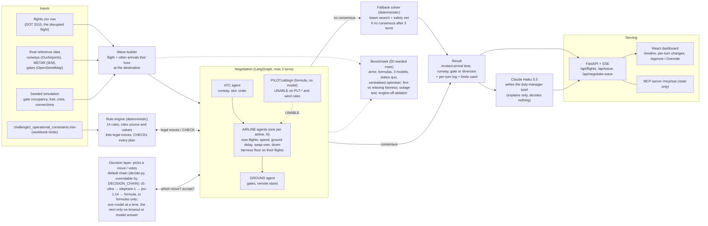
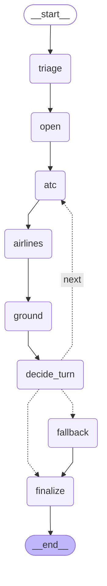

# Final Approach: disruption negotiation for arrival waves (Autonomous SG 2026, Airbus Challenge 2)

Design: `docs/superpowers/specs/2026-10-31-disruption-negotiator-design.md` · API contract: `docs/api-contract.md`

**Live demo:** https://disruption-negotiator.onrender.com · **Deck (36 s):** [YouTube](https://youtu.be/JpgnufOeDQQ) · [MP4](deck/final-approach-deck.mp4)

[](https://youtu.be/JpgnufOeDQQ)


## 1. Pitch

When weather or a late inbound disrupts an arrival, the airline duty manager coordinates by phone between the tower, the crew and ground handling. This prototype replaces those calls with software agents: ATC, GROUND and one agent per airline that has a flight in the wave (2 + N voters; see the next paragraph for why this is not the challenge's three). Pilots appear too, but only to refuse (UNABLE). The input is one real disrupted flight, a row of `data/challenge2/flights.csv` (DOT 2015, `WEATHER_DELAY > 15` or `LATE_AIRCRAFT_DELAY > 20`). The wave is built at its destination airport, with the other `flights.csv` arrivals in the same window as context and weather fetched on demand from IEM (cited). Each agent sees only its own domain and can only make moves inside its own authority. An airline agent speaks for its own flights and may not accept a plan that makes one of them worse than a reference plan, with one stated exception (section 3, firm fairness). A deterministic rule engine decides whether any move or plan is legal; no model ever does. Decision models choose among the options the engine offers and vote. Claude (Haiku 5.5) only narrates the finished outcome for the duty manager and decides nothing; every run from the UI gets a brief, with a deterministic template if Claude is unavailable. In the default mode (formulas, chosen by the benchmark) no model takes any decision; decision models run in `decision` and `decision+claude` modes. The output is a revised arrival (time, runway, gate, action, delay vs schedule) plus the full log, and the human approves or overrides. BTS Jun-Aug 2024 waves are still supported as a second source.

### Deviation from the workbook's `rules_of_play`

The workbook sheet `rules_of_play` says: "One turn = each of the three agents sends one structured message." This build does not follow that. A turn here is one message from each **voter**: ATC, one `AIRLINE:<code>` agent per airline with a flight in the wave, and GROUND (2 + N voters; over the 50 benchmark waves 3 to 6). On top of that there is one formula pilot per flight (`PILOT:<callsign>`). Pilots never vote, never propose and make no model calls. They only answer UNABLE when an instruction or plan breaks one of their own rules (`PLT-*` and `ATC-WIND-LIMITS`). This is the default mode, not a switch. Waves with one airline still have 3 voters, which is the case for the two stress waves below.

Why:

- **Realism.** A pilot does not bargain over slots; they accept an instruction or say "unable", for safety only. The airline's operations centre decides which of its own flights absorbs a delay (14 CFR 121.533 on shared operational control, FAA Collaborative Decision Making, slot substitution), because only it sees connections, crew duty and the next departure.
- **Evidence.** In the 4 Nov stress test on the two most disrupted 2024 waves, the old three-agent plans left the airline worse off and nobody objected. With airline agents (formulas mode, firm fairness) both waves now reach consensus in 2 turns on the status quo:

| Wave | Old three-agent plan (delay, fuel) | v4-airlines, firm (delay, fuel) | What happened |
|---|---|---|---|
| CLT-2024-07-29-19 | 1,086 min, +1,376 kg vs status quo (status quo 1,053 min) | 1,053.3 min, 0 kg | turn 1: the airline rejects ATC's plan (e.g. AA2712 +15.5 min); turn 2: consensus on the status quo |
| ATL-2024-07-18-21 | 1,225 min, +448 kg vs status quo (status quo 1,216 min) | 1,216.2 min, 0 kg | same pattern, consensus in turn 2 on the status quo |

Both waves give the same result under firm and relaxing. The benchmark in section 5 measures the cost: every agreed plan is legal, and the airlines' floor costs consensus and some rounds.

## 2. Live demo and local run

Live: https://disruption-negotiator.onrender.com

Render free tier: it sleeps when idle, so expect a cold start of about 1 minute.

Local:

```bash
pip install -r requirements.txt
uvicorn backend.server:app --port 8000        # API, MCP and (if built) the dashboard at http://localhost:8000
```

Frontend build (served at `/` from `frontend/dist` when present; without it the API still runs):

```bash
cd frontend && npm ci && npm run build
```

Docker (multi-stage: builds the frontend, then the Python API; listens on 7860):

```bash
docker build -t disruption-negotiator .
docker run -p 7860:7860 disruption-negotiator
```

Keys are optional and live in `.env` (gitignored): `OPENROUTER_API_KEY`, `TYPESAFE_API_KEY`, `ANTHROPIC_API_KEY`. With none set, negotiation runs on the local formulas and narration uses a deterministic template. The Docker image sets `ATM_REQUIRE_REAL=1`.

## 3. Architecture

Input: pick a flight with `GET /api/flights`, id `F2015-<row_id>` (BTS 2024 wave ids still work).

### System



### Negotiation graph (exported from LangGraph)



Protocol (`backend/wave/graph.py`, LangGraph). Per turn each voter (ATC, then the airlines in alphabetical order inside the one `airlines` node, then GROUND) sends ONE `AGENT_TURN` message holding its moves, the moves the engine rejected with their violations, its proposal, its votes and a rationale. The engine runs a `CHECK` after every proposal. A pilot sends `UNABLE` (not an `AGENT_TURN`) when a move the engine rejected, or a plan on the table, breaks one of that flight's own pilot-side rules. UNABLE is a message in the log; the engine's `CHECK` still decides legality. Consensus means all voters `ACCEPT` the same plan that passed `CHECK`, within a turn. After at most 3 turns without consensus, a deterministic beam solver with a safety net produces the plan and the reason is logged.

Components (all under `backend/`):

- **Wave builder** (`wave/flights2015.py`, `wave/build.py`): builds the wave from a `flights.csv` row (or a BTS 2024 wave), real runways, METAR, FAA registry and OSM gates, plus seeded simulation of what no public source has. Deterministic per id.
- **Workbook limits** (`wave/constraints.py`): airport capacity, wake table, fuel and crew rules parsed from `data/challenge2/challenge2_operational_constraints.xlsx` (sheet `rules_of_play`), with hard-coded fallbacks equal to the workbook.
- **Rules engine** (`wave/rules.py`): every check is a formula, and every result cites rule, source and input values. Fourteen rules:
  - `ATC-RWY-OPEN`: runway exists and is open.
  - `ATC-WAKE-SEP`: workbook wake distance (3-8 nm) between leader and follower on the same physical runway, converted to time at 140 kt (x1.25 when wet or low visibility).
  - `ATC-RWY-CAPACITY`: arrivals per runway per rolling 60 min within the workbook cap.
  - `ATC-TAXI-ROUTE`: taxi route to the gate is usable.
  - `ATC-TAXI-CONFLICT`: the landing taxis to its stand against the fixed 2015 ground traffic and earlier wave flights (hold-short / give-way waits within the 30-min horizon) and has vacated its runway before the next landing or takeoff on it. Waits cost in-block time, they never fail it.
  - `ATC-HOLD-STACK`: at most 5 simultaneous holders per physical hold fix, 1,000 ft apart, bottom-first exit (a later entrant may not leave while an earlier one still holds).
  - `ATC-WIND-LIMITS`: crosswind and tailwind from real METAR against FAA Order 8400.9 section 6d and demonstrated crosswind by type.
  - `PLT-EARLIEST-ETA`: no landing before the flight can physically arrive.
  - `PLT-FUEL-RESERVE`: hold fits within extra fuel above alternate plus 30 min final reserve.
  - `PLT-CREW-DUTY`: in-block (or alternate arrival) within 13 h of crew report time; report = scheduled departure - 60 min. A bust that even the earliest landing cannot avoid is reported, not vetoed.
  - `GND-GATE-SIZE`: gate fits the aircraft.
  - `GND-GATE-FREE`: gate not occupied, including by other wave flights, with the airport turnaround time.
  - `GND-GATE-NOTICE`: gate changes need at least 20 min notice.
  - `GND-CREW-DUTY`: reports ground overtime past the 8 h shift. It never vetoes; overtime is a cost.
- **Moves and authority** (`wave/moves.py`): ATC changes runway, slot and order. An airline agent changes only its own flights (speed reduction, ground delay, divert, accept, and `swap_own`: swap the slots of two of its own flights on the same runway). GROUND changes gates only. Pilots have no moves.
- **Airlines** (`wave/airlines.py`): a static table groups carrier codes into airlines (a regional flies under its major, for example OH to AA). BTS data has the operating carrier only, so where the table has no row the operating carrier is its own airline; each wave lists its airlines and the basis of each grouping (`Wave.airlines`).
- **Pilots** (`wave/unable.py`): one per flight, formulas only. A pilot refuses only on the `PLT-*` rules and `ATC-WIND-LIMITS`.
- **Utilities** (`wave/utility.py`): ATC scores the wave, each airline the weighted mean over its own flights, GROUND gates and crew (overtime at 1.5x). Voting uses a reservation schedule that drops each turn.
- **Fairness floor** (`wave/fairness.py`, `ATM_FAIRNESS=firm|relaxing`): an airline objects to a plan that makes one of its flights worse than a reference plan on delay or fuel: the status quo when it is feasible, else the best CHECK-passed plan seen so far. **Firm** (shipped): an airline never accepts such a plan, except when no CHECK-passed plan on the table meets its floor (the escape clause, so a wave can still end). **Relaxing**: the floor loosens each turn on the reservation schedule (a flight may be worse by up to 6.0 / 13.2 / 20.4 min of delay in turns 1 / 2 / 3, plus a fuel allowance on the same scale). Shipped as firm by the user's choice, see section 5.
- **Safety**: every move and every proposal is engine-checked, votes are cast only on `CHECK`-passed plans, the final plan's feasibility is re-checked, and models only choose among offered options.
- **Decision layer** (`decide.py`): per call, a chain of OpenRouter models, then TypeSafe (Jev), then local formulas. Each call has a 2 s timeout and one retry on 429/5xx. A circuit breaker skips an entry for 60 s after 3 consecutive failures. Every fallback is logged and shown in the UI.
- **Fallback solver** (`wave/fallback.py`): beam search over legal moves maximising the worst agent's utility, with a remote-stand, ground-delay or divert safety net. Legality is still decided only by the rules engine. It never raises.
- **Narration** (`wave/narrate.py`): Claude writes the brief from the structured outcome; deterministic template on any failure.
- **API and SSE** (`server.py`): REST under `/api` (`/api/flights`, `/api/waves`, `/api/wave/{id}`, `/api/runs/{id}`, `/api/benchmark`, `/api/config`) and `POST /api/negotiate-wave`, which streams messages as server-sent events. Output is `result.revision` plus the full log. Contract v2.0 is `docs/api-contract.md`.
- **MCP server** (`mcp_server.py`): read-only, at `/mcp/sse`. Six tools: `list_waves`, `get_wave`, `fcfs_plan`, `legal_moves`, `check_plan`, `negotiate` (formulas only).

### Limits applied (`rules.LIMITS`, `rules.limits_for`)

Every change and assumption is returned in `result.limits`. Summary:

| Limit | What we do | Source |
|---|---|---|
| Wake separation | Workbook distances (`min_separation_nm`, 3-8 nm) converted to time at a 140 kt approach speed (3 nm = 77 s, 5 nm = 129 s, 8 nm = 206 s); same physical runway | workbook (nm column); 140 kt is an assumption |
| Wet or low-visibility factor | x1.25 on wake times | assumption |
| B757 | Treated as Heavy | assumption |
| Runways and wind | Real runways and METAR instead of the workbook runway count (used only as the capacity divisor) | real data |
| Runway capacity | `max_runway_ops_per_hour / active_runways` per runway; counts arrivals only | workbook, arrivals only |
| Turnaround, gates, spare gates | Per airport from workbook (turnaround 45/35 min, spare gates); wave models `min(gates, 12)` gates plus a remote stand with 2 positions | workbook; remote stand is an assumption |
| Fuel burn, reserve, spare | 2400 / 6500 kg/h, 30 min final reserve, 45 min spare fuel | workbook |
| Contingency fuel 5% | Not credited: it covers en-route deviations, and the workbook's 45 min spare-on-arrival is what is checked at the destination. Not crediting it is the conservative reading | assumption |
| Flight crew 13 h duty | Enforced by `PLT-CREW-DUTY`; report time = scheduled departure - 60 min | workbook; report offset is an assumption |
| Ground shift | 8 h, overtime at 1.5x is a cost, not illegal | workbook |
| Gate change notice | At least 20 min; remote stand exempt | workbook |
| Speed reduction | Capped at 8 min | assumption |
| Taxi-in time (engine `v3-taxi`) | In-block = landing slot + runway occupancy time (roll to the first forward exit past the required roll) + unimpeded taxi on the OpenStreetMap taxiway graph from that exit to the gate's stand (gates bound to OSM stands; 20 kt, 10 kt on taxilanes and turns > 30°, + 30 s to park). Tiers: real (OSM route); generic (runway end missing from today's OSM, a wave below the 80 % surface quality gate, or an unbound gate: straight line runway midpoint to gate x1.4 at 15 kt); no geometry (no runway coordinates: 6 min near / 10 min far). Remote stand + 10 min bus; no taxiway closures. The time is unimpeded: no ramp, gate or queue waits until `ATC-TAXI-CONFLICT` schedules hold-shorts, so it sits below BTS `TAXI_IN`. Validation without fitting (benchmark focus flights on the real surface tier with a real `TAXI_IN`, ROT + routed taxi vs `TAXI_IN`): n 42, MAE 3.37 min, bias -2.78 min, per-airport table in `eval/BENCHMARK.md` (Taxi-in validation). Figures quoted here earlier were FCFS medians over all flights of the replay waves, not this validation | real data (OSM, ODbL); speeds, generic tier and 6/10 min fallback are assumptions |
| Time base (engine `v3-time`) | BTS scheduled arrival (STA) is a gate (in-block) time. Earliest landing = STA + attributed BTS delays (late aircraft, carrier, weather, NAS) - taxi-in reference (the row's real `TAXI_IN`, else the airport's 2015 median over the challenge's delayed-flight rows, else 6 min). For a 2015 row that is the real wheels-on whenever the attributed delays sum to `ARRIVAL_DELAY` (security delay is not attributed). Delay = max(0, in-block - STA), also for `delay_vs_schedule_min`. Fixed-traffic arrivals land at their real wheels-on (STA + `ARRIVAL_DELAY` - `TAXI_IN`) but are still picked by scheduled time, so a late one can land hours after the window. Crew floors and `PLT-CREW-DUTY`'s "unavoidable" test use ROT + unimpeded routed taxi to the gate, minimised over the open runways. In-block uses that unimpeded routed taxi (see Taxi-in time), so the FCFS delay of a flight sits below its real BTS delay by (taxi-in reference - ROT - unimpeded taxi) when that is positive | real data (BTS `ARRIVAL_DELAY`, `WHEELS_ON`, `TAXI_IN`); 6 min fallback is an assumption |

### Flight paths and the airport surface (engine `v3-traffic`)

The plan is no longer only a table of slots. Every landing now has a flown path, and the same plan drives the radar and the surface map on one replay clock.

- **Air.** Each flight flies a published route: the FAA CIFP 2611 STAR and approach (or a synthetic corner-post and downwind route where the airport has none, drawn dashed), at the terminal speed profile. Flights that lap enter a holding stack (1,000 ft levels, bottom-first exit) at the hold fix of its STAR (the first fix of the common route, else the last enroute-transition fix). The slot, the fuel burned in the hold and the lap count all come from that same path, so the radar draws what the engine used and nothing else.
- **Ground.** After touchdown the flight rolls to the first forward exit past the required roll and taxis the fastest route on the OpenStreetMap taxiway graph to its bound stand. The real 2015 movements of the same hour (queue arrivals and departures) are scheduled once as fixed traffic, and each wave flight waits at a node or a runway hold until the headway, crossing gap and runway-vacate rules are met. Those waits are the amber bars on the surface map and they add to in-block time.
- **Legality stays in the rule engine.** `ATC-HOLD-STACK` and `ATC-TAXI-CONFLICT` are deterministic rules like the other twelve (14 in all); no model decides whether a path is legal. Every point and segment carries `src: "cifp" | "osm" | "synth"` and synthesized parts are drawn dashed.
- **Offline.** Procedures, surface and movements are derived files in `data/ref/` (and seeded into Postgres); the runtime never fetches CIFP, OSM or BTS.

Screenshots (replay mode, no keys): the status-quo plan of `F2015-7053` with ASQ4125 (EV4125) in its hold at WATSN, and `F2015-75` at DFW with AAL2441 waiting to give way to AA2498.


## 4. Data and provenance

| Layer | Source | Status |
|---|---|---|
| Focus flight, delays, context arrivals | DOT 2015 `flights.csv` (challenge file) | real |
| Second source: flights, delays, queue | BTS On-Time, Jun-Aug 2024, arrivals to 30 hubs | real |
| Runways (ends, headings, length) | OurAirports | real |
| Weather at arrival hour (wind, visibility, ceiling, wet/dry) | Iowa Environmental Mesonet METAR archive, fetched on demand and cited | real |
| Airport capacity, turnaround, wake table, fuel and crew rules | challenge workbook (synthetic planning numbers) | given by the challenge |
| Tail to aircraft type, wake category, gate size | FAA aircraft registry | real (US-registered tails) |
| Gates and wide-body gates | OpenStreetMap, 10 hubs | real |
| Arrival procedures (STARs, approaches, hold fixes) | FAA CIFP, cycle 2611, pinned (`scripts/fetch_cifp.py`) | real; **Procedures: FAA CIFP 2611, not for navigation** |
| Airport surface (taxiways, runways, stands, holding positions) | OpenStreetMap via Overpass (`scripts/fetch_surface.py`), ODbL | real; **© OpenStreetMap contributors**, not for navigation |
| Real ground traffic of the wave hour (arrivals, departures, taxi times) | BTS On-Time 2015 (`flights.csv` movements, `data/ref/movements2015`) | real |
| Gate occupancy | seeded simulation | simulated, badged |
| Fuel on board | seeded simulation | simulated, badged |
| Crew shifts | seeded simulation, anchored to the flight's actual delayed ETA | simulated, badged |
| Passenger connections | seeded simulation | simulated, badged |
| Two wide gates per hub where OSM has none | simulated | simulated, badged |

Layers missing for a flight fall back to a generic model and are badged in the UI. Procedures: FAA CIFP 2611, not for navigation. The derived procedure and surface files are for this simulation only and are not for navigation. Map data © OpenStreetMap contributors (ODbL).

### Data: Postgres (Neon) with file fallback

Reference data, runs and decisions live in Neon Postgres. The files under `data/` stay in the repo and are the fallback: the app serves from them when no database is configured or the database is down.

| Variable | Used by | Meaning |
|---|---|---|
| `DATABASE_URL_POOLED` | app runtime (`PgStore` pool), Render, `scripts/db_timings.py` | Neon pooled (`-pooler`) endpoint, `sslmode=require`. The only database secret on Render. Unset: the app uses files. |
| `DATABASE_URL` | `scripts/db_migrate.py`, `scripts/db_seed.py`, `scripts/db_dump_live.py` | Neon direct endpoint, owner role. Dev machine only; never put it on Render. |
| `DATABASE_TEST_URL` | live DB tests | Direct owner URL of a separate `atm_test` database in the same Neon project. |
| `ATM_STORE` | app | `files` forces the file store; `pg` requires `DATABASE_URL_POOLED`. |
| `ATM_LIVE_DB` | tests | `1` enables the opt-in live tests. |
| `ATM_WARM` | app | Default `1`: a one-shot daemon thread loads the flights.csv index and builds the replay (demo) waves so the first page load is fast (started at boot with the file store, else by the first request, normally Render's `/api/config` health check). `0` turns it off (the test suite sets it). |
| `ATM_PLAN_CACHE` | app | Default `256`: plans whose 4D trajectories are kept in memory (about 125-170 KB each, so about 43 MB at most). Edit suggestion searches never add to it. A missing, non-numeric or < 1 value means 256. The offline benchmark raises it to 256 x its concurrency for the run (still one shared cache). |

Neon setup: project in region `aws-us-west-2` (Oregon, next to Render's default `oregon`; a region cannot be changed later). Fix the compute at 0.25 CU (min = max) in the Console; autoscaling would burn the free 100 CU-hours up to 8 times faster. Keep a `test` branch (or the `atm_test` database) for the live tests so they never touch the production data.

```bash
python3 scripts/db_migrate.py            # apply migrations/NNNN_*.sql as the owner (append-only, checksummed)
python3 scripts/db_seed.py               # load the reference data (idempotent, shadow-table swap, 750 MB guard)
python3 scripts/db_seed.py --check       # verify row counts and checksums against the files
ATM_LIVE_DB=1 python3 -m pytest -q -m live_db   # optional: live tests against DATABASE_TEST_URL
python3 scripts/db_dump_live.py          # back up live.runs and live.decisions to .cache/dump/*.jsonl
python3 scripts/db_timings.py            # p50/p95 per path against the design budgets (add --after-idle for a wake-up sample)
```

First production seed, in order:

1. `python3 scripts/db_migrate.py`
2. `python3 scripts/db_seed.py`. Careful: the default dataset list includes `runs_import`, which loads every run in your local `eval/runs/` folder into the production `live.runs`. Review or clean that folder first, or name the datasets explicitly and leave `runs_import` out (`python3 scripts/db_seed.py small workbook waves bts_arrivals metar_2024 iem_cache flights2015 disruptions_v1 replays benchmark v1_eval procedures surface movements2015`).
3. `python3 scripts/db_seed.py --check` (must report no mismatches)
4. In the Render dashboard set `DATABASE_URL_POOLED` (the pooler URL). Never set `DATABASE_URL` there.
5. Redeploy.
6. Run one negotiation and approve it; note the run id.
7. Redeploy again.
8. Confirm `GET /api/runs/<id>` still returns that run, and `GET /api/config` shows `"backend": "postgres"` and `"degraded": false`.
9. `python3 scripts/db_timings.py` from the dev machine.

Rollback: unset `DATABASE_URL_POOLED` in the Render dashboard and redeploy. The app is back on files (runs saved while it was on Postgres stay in the database; `scripts/db_dump_live.py` exports them).

`DATABASE_TEST_URL` is a separate `atm_test` database in the same Neon project (a Neon `test` branch also works); the live tests never touch the production database.

Measured sizes (1 GB free limit): `atm_test` with all reference data 152 MB; the raw datasets add an estimated ~158 MB (they load only when named). When the build is finished, free that space: from the owner connection to the production database (`DATABASE_URL`), run `drop database atm_test;`.

Statement timeout: migration `0006` sets `statement_timeout = '5s'` on the role that runs it (the owner, which `DATABASE_URL_POOLED` uses for now), in that database only, so a runaway query from the app is cancelled after 5 s. It is a role setting because `SET` does not survive the pooler. `db_seed.py`, `db_migrate.py` and `db_dump_live.py` lift it to 0 on their own connections so long loads and exports finish. The limit also applies to your own sessions as the owner (Neon SQL editor, psql): run `set statement_timeout = 0;` first for manual maintenance. Apply `0006` to `atm_test` too (`python3 scripts/db_migrate.py --url-env DATABASE_TEST_URL`).

Fallback behaviour: every read and write goes through `FallbackStore`. A failed or timed-out call is retried (except `record_decision` and `put_benchmark`, which are not idempotent), then served from files; three consecutive failures open a breaker for 60 s. `GET /api/config` never queries the database. Read its `store` object: `"backend": "postgres"` with `"degraded": false` is healthy. `"backend": "files"` with `"degraded": true` (and a `reason`) is the fallback: a database is configured but unreachable, and runs saved then are not persistent. `"backend": "files"` with `"degraded": false` means no database is configured. A write the database rejects (a constraint, bad data, a missing table or privilege) is kept in the files and shows as degraded, without opening the breaker; an empty (unseeded) table is served from files the same way.

What changed in the v3 build:

- **`raw.*` only when named.** The raw challenge tables (about 120 MB, never read by the app) are no longer in the default dataset list: `python3 scripts/db_seed.py raw` loads them, `--drop raw` removes them.
- **`replays` prunes.** Seeding `replays` deletes the `eval.replays` rows whose `(wave_id, engine_version)` is not in `data/replay/`, so only the recorded files stay.
- **Geometry is documents, not points.** The app reads one gzipped document per airport from `geo.procedures` and `geo.surface` (and `geo.movements2015_day` for the fixed traffic), seeded by the `procedures`, `surface` and `movements2015` datasets. Migration `0007` dropped the point tables (`geo.fixes`, `geo.stands`, `geo.osm_gates`, `geo.holding_positions`), `geo.coverage` and the PostGIS extension; nothing queries by location. The coverage report is the file `data/ref/GEO_COVERAGE.md` (`scripts/geo_coverage.py`).

Compute hours: the free plan gives 100 CU-hours a month, which is 400 active hours at 0.25 CU. Compute suspends 5 minutes after the last query. Do not add a keep-alive, a timer query or a database call to the health check: a database that is never idle uses about 183 CU-hours a month and the budget is gone in about 16 days. If the budget runs out, the site keeps running on files (degraded).

Optional, later: a least-privilege login for the runtime. Until then `DATABASE_URL_POOLED` uses the owner role and nothing depends on `atm_app`. Run this once as the owner (the Neon SQL editor or `psql`), choosing the password yourself:

```sql
create role atm_app login password '<password>' in role app_read, app_write;
alter role atm_app set statement_timeout = '5s';
alter role atm_app set search_path = ref, live, eval, geo, extensions;
```

The `statement_timeout` line gives `atm_app` the same 5 s limit that `0006` gives the owner (`0006` only covers the role that ran it). `atm_app` needs both groups: `app_write` alone has no `SELECT`, which `UPDATE ... WHERE` and `ON CONFLICT` need. Then point `DATABASE_URL_POOLED` (in `.env` and Render) at the pooler URL for `atm_app`.

## 5. Evaluation

**What the measured impact is:** every agreed plan obeys every rule (0 violations in agreed plans, every arm, both fairness variants), while the uncoordinated status quo breaks at least one rule on 24 of 50 waves; with the rule engine switched off, 48% of the formula arm's plans are illegal. Delay is roughly neutral: on the 26 waves where the status quo is legal, the negotiated plans are 1.7 to 4.0 min better in total (320.6 to 323.0 min against 324.7). On all 50 waves the negotiated mean delay is above the status quo's (334.0 to 335.5 min against 326.7); the status quo is illegal on 24 of them, so that comparison is not like for like. Negotiation buys legality first; minutes are a small bonus. The airline agents add a second guarantee: under the shipped firm floor no agreed plan leaves any flight worse than in the status quo on delay or fuel (0.0% of agreed waves with a feasible status quo, against 57.7 to 61.5% under relaxing). That costs consensus and rounds, listed below.

Method (`python3 -m backend.wave.benchmark --n 50 --arms <models>,formula --concurrency 4 --seed 7`):

- 50 seeded `flights.csv` rows, stratified over the 30 busiest hubs (BTS 2024 waves remain available with `--source bts`).
- Selection rule: best outcome among arms with error < 2%, p95 < 1 s and consensus >= 90%; tie goes to lower Brier.
- Arms: each candidate decision model (full chain behavior, same waves), the formula arm (no model), and the status quo (FCFS slots, scheduled gates, no coordination).
- Metrics:
  - consensus %: waves that reached agreement within 3 turns; fallback % is the rest, ending in the deterministic solver.
  - error rate: % of decisions answered after the arm's model failed (non-empty `fallback_from`).
  - latency p50/p95: over model-answered decisions only.
  - Brier: mean `(p_accept - y)^2` over model-answered votes, where `y` is the formula verdict (utility at or above reservation). It measures agreement with the formula, not with ground truth.
  - agreement with formula: share of decisions matching the formula arm.
  - outcome means (delay, fuel, passengers protected, crew overtime): over waves that succeeded in every arm.
  - status-quo comparison: the status quo may itself break rules, so regressions against it are reported only on waves where the status quo is feasible.
- Outage test: the primary model is replaced by an invalid id and the chain must still resolve every wave.
- Engine-off ablation: the share of formula-arm final plans that are infeasible under the real rules when the rules engine is disabled.

<!-- BENCHMARK -->
Run: `python3 -m backend.wave.benchmark --source flights2015 --n 50 --arms openrouter:typesafe/jev-1.14,openrouter:liquid/d1-ultra,openrouter:baseten/elephant-1,formula --concurrency 4 --seed 7 --outage-n 20` (4 Nov 2026, engine `v4-airlines`, live models, firm fairness). The same 50 flights.csv rows (seeded, stratified over 30 hubs) for every arm; all arms finished all 50. Every number below is from `eval/benchmark.json`; the full tables are in `eval/BENCHMARK.md`, the per-variant runs in `eval/variants/`.

**Arms, shipped variant (firm)**

| Arm | Consensus | Fallback to solver | Mean rounds | Rule violations | Delay, all arrivals (min) | Fuel (kg) | Pax protected | Brier* | p50 / p95 ms | Errors | Same decision as formulas |
|---|---|---|---|---|---|---|---|---|---|---|---|
| typesafe/jev-1.14 | 94% | 6% | 1.98 | 0 | 334.1 | 148.7 | 34.7% | 0.0083 | 416 / 509 | 0% | 62% |
| liquid/d1-ultra | 96% | 4% | 1.88 | 0 | 334.0 | 132.5 | 34.7% | 0.0012 | 545 / 957 | 0% | 70% |
| baseten/elephant-1 | 94% | 6% | 2.00 | 0 | 334.4 | 152.6 | 34.4% | 0.0137 | 484 / 587 | 0% | 60% |
| formula | 98% | 2% | 1.92 | 0 | 335.5 | 154.7 | 34.4% | n/a | n/a | 0% | 100% |
| centralised optimiser (beam search, no negotiation) | - | - | - | 0 infeasible | 329.4 | 83.2 | 34.7% | - | - | - | - |
| status quo (no negotiation) | - | - | - | breaks a rule on 24/50 waves | 326.7 | 1.4 | 36.9% | - | - | - | - |

\* Brier is measured against the formula verdict (accept if utility >= reservation), not ground truth. Delay, fuel and pax are means over the 50 waves. The status quo is illegal on 24 of them, so its lower delay is not a like-for-like win.

**Selection.** The rule is unchanged: best outcome among arms with error < 2%, p95 < 1 s and consensus >= 90%; tie goes to lower Brier. It selects `liquid/d1-ultra` (n = 50: indicative, not statistically significant). The default chain in `decide.py` starts with it.

**Fairness variants.** Same waves and arms under each variant. "Worse flight" = share of agreed waves with a feasible status quo where any flight is worse than in the status quo on delay (> 0.05 min) or fuel (> 0.5 kg). "Worse wave-total" = share of waves with a feasible status quo whose final plan (consensus or fallback) has a worse wave-total delay or fuel. v3-traffic recorded wave totals only.

| Variant | Arm | Consensus | v3-traffic consensus | Worse flight | Worse wave-total | v3-traffic worse wave-total | Model calls per wave | p95 ms |
|---|---|---|---|---|---|---|---|---|
| firm (shipped) | jev-1.14 | 94% | 98% | 0.0% | 0.0% | 65.4% | 20.7 | 509 |
| firm (shipped) | d1-ultra | 96% | 96% | 0.0% | 0.0% | 61.5% | 18.7 | 957 |
| firm (shipped) | elephant-1 | 94% | 96% | 0.0% | 0.0% | 61.5% | 20.5 | 587 |
| firm (shipped) | formula | 98% | 98% | 0.0% | 0.0% | 65.4% | 0 | n/a |
| relaxing | jev-1.14 | 100% | 98% | 61.5% | 57.7% | 65.4% | 15.3 | 521 |
| relaxing | d1-ultra | 100% | 96% | 57.7% | 53.8% | 61.5% | 14.5 | 1,306 |
| relaxing | elephant-1 | 98% | 96% | 57.7% | 53.8% | 61.5% | 15.1 | 680 |
| relaxing | formula | 100% | 98% | 61.5% | 57.7% | 65.4% | 0 | n/a |

- **The automatic pick was relaxing; firm is shipped by the user's choice (4 Nov 2026).** The pick rule: a variant passes if every arm's consensus is at least the v3-traffic arm's minus one wave (2 points at n = 50); among passing variants the lower worse-flight share wins. Firm fails it in jev-1.14 (94% against 98%, two waves lower; elephant-1 is one wave lower, inside the tolerance). The user chose firm because relaxing leaves 57.7 to 61.5% of agreed waves with a flight worse than its status quo, and firm leaves none.
- **What firm costs:** consensus 94 / 96 / 94 / 98% (jev-1.14 / d1-ultra / elephant-1 / formula) against 98 / 96 / 96 / 98% in v3-traffic. That is 2 more fallback waves in jev-1.14 and 1 more in elephant-1. Relaxing reaches 100 / 100 / 98 / 100%. Firm also takes about half a round more (mean rounds 1.88 to 2.00, against 1.46 to 1.50) and about 5 more model calls per wave than relaxing (jev-1.14 20.7 against 15.3). Firm burns less fuel than relaxing (132.5 to 154.7 kg against 210.2 to 223.7 kg per wave).
- **Regressions against v3-traffic: 66 wave-arm rows** (19 d1-ultra, 16 jev-1.14, 16 formula, 15 elephant-1; 57 on delay, 9 on fuel). Every row has the cause `negotiation`: `physics_delta` is 0.0 on every metric, and the status quo is identical (326.69 min, 1.36 kg, 26 feasible waves). They are not all small: the largest delay rise is 54.4 min (`F2015-163396`, formula, 185.6 to 240.0) and the largest fuel rise is 168 kg (`F2015-251827`, d1-ultra, 12 to 180). The first 20 rows are listed in `eval/BENCHMARK.md`, all 66 in `eval/benchmark.json`. We have not measured per wave why the airline floor moves the plan in each of them.
- **Consensus fallbacks** (firm, solver took over): jev-1.14 3 waves (`F2015-112396`, `-208692`, `-246479`), d1-ultra 2, elephant-1 3, formula 1. Mean delay is flat across variants (334.0 to 335.5 min in firm, 333.4 to 334.6 min in relaxing).
- **Safety:** 0 rule violations in agreed plans in all four arms of both variants. **Engine-off ablation:** 48% of the formula arm's final plans break a rule when the engine is disabled. **Outage test:** primary model replaced by a dead endpoint on 20 waves; 20/20 resolved with a legal plan (both variants).
- **Latency and cost:** d1-ultra's p95 under firm is 957 ms (under 1 s); under relaxing it was 1,306 ms. `cost_usd_per_wave` is not measured (0.0 in the file).
- **Earlier engines:** the engine history table in `eval/BENCHMARK.md` runs from v2 to v4-airlines. The v3-traffic numbers are archived in `eval/archive/`. The 100-row and 1,000-row runs (`eval/BENCHMARK_100.md`, `eval/BENCHMARK_1000.md`) were made on earlier engines and were not re-run; do not compare them with the table above.
- Full report: `eval/BENCHMARK.md`, raw data `eval/benchmark.json`.
<!-- /BENCHMARK -->

### Cost of model calls

Measured on 31 Oct 2026 from the OpenRouter key's usage counter before and after 20 random live flights.csv waves in decision mode (jev-1.14): **191 model calls for $0.0097**, so about **$0.00005 per call** on the v2 call pattern (9.6 calls per wave). Airline agents add model decisions: the v4-airlines benchmark (firm) counts 18.7 to 20.7 model calls per wave (relaxing 14.5 to 15.3), about twice the v2 pattern. At the measured price per call that is roughly $0.001 per wave. This is an estimate: the benchmark does not measure cost, and the price per call was not re-measured on v4.

| Item | Per wave | Per 1,000 waves | Source |
|---|---|---|---|
| jev-1.14 decisions (OpenRouter) | ~$0.001 | ~$1 | estimate: 20.7 calls (benchmark, firm) x $0.00005 (measured on v2) |
| Claude Haiku 5.5 brief (one call, max 1,500 output tokens) | at most ~$0.0016 | at most ~$1.60 | Anthropic list price $0.10 / $0.50 per million input / output tokens; upper bound assuming 8k input tokens and the full output cap |
| Formulas mode | $0 | $0 | no model calls |
| **Total, decision mode with brief** | **about $0.003** | **about $3** | |

Replays cost nothing (no model calls). The path and surface layers add no model calls either: trajectories, taxi routes and the hold-short schedule are deterministic code, and `GET /api/wave/{id}/geo` and `POST /api/trajectories` are pure computation. The v3 and v4 benchmarks record no cost (`cost_usd_per_wave` is 0.0, output tokens free, input cost not measured), so the per-call price comes from the 31 Oct measurement on the v2 call pattern. Pilot agents make no model calls.

### Demo replays

Recorded runs in `data/replay/` (engine v4-airlines, decision mode, firm fairness, live decision model `liquid/d1-ultra`, 0 model fallbacks) play back with no model calls. All 5 reach consensus. An airline agent put an objection on the record in every one of them, and the agreed plan has a flight in a holding pattern (a "lap" on the radar) in 2 of the 5 (ORD, MIA). ATL laps only in the status quo. There is no UNABLE in any replay: UNABLE appears only when a pilot-side rule fails for that aircraft on a rejected move, a new proposal or the opening plan, and none did here. Waves without a recording run live. Delay and fuel are wave totals of the agreed plan against the status quo (first come, first served), from the recordings.
- `F2015-7053` ORD (airlines AA, OO, UA; 3 turns): MQ3269 on 32R, gate B22, +395 min. ATC proposes moving EV4125 to 22R and EV3273 to 28R to remove EV4125's lap. UA rejects it in every turn on its floor (EV3273 delay +6.3 min against the original plan, and 3 more objections). ATC gives way in turn 3 and the agreed plan is the status quo: delay 644.0 min, fuel 228 kg, pax protected 17.9 %, unchanged. EV4125 still laps once (5.7 min).
- `F2015-292602` MIA (AA; 2 turns): AA943 on 08L, gate A4, +314 min. The status quo fails GND-GATE-FREE (AA1202 and AA1254 on gate A2), so the agreed plan is the only legal one. In turn 1 AA rejects ATC's plan (AA1202 fuel +256 kg against the best plan so far) and counter-offers that AA1202 absorbs 8 min by speed reduction. In turn 2 the plan agreed is the one with AA943 on runway 30 and AA1006 on 08R. Cost: delay 505.2 to 540.4 min, fuel 0 to 1,532 kg, pax protected 17.3 to 12.9 %. AA1202 laps 7 times.
- `F2015-152758` ATL (DL; 2 turns): DL2256 on 08L, gate T11, +313 min. In the status quo DL1532 and DL1600 each lap once and it fails GND-GATE-FREE (DL1532, DL1537 and DL1600 on gate E17). Turn 1 GROUND moves two of them to gates E15 and E16. In turn 2 DL objects to ATC's new plan (DL2256 delay +5.5 min against the best plan so far, and 2 more) and the agreed plan keeps DL2256 on 08L with the gate changes. It is legal and better: delay 757.4 to 746.8 min, fuel 564 to 152 kg, no lap.
- `F2015-75` DFW (AA; 3 turns): AA1344 on 35C, gate A38, +113 min. ATC wants AA2441 and MQ2833 on 35L to cut their taxi waits. AA rejects it in all 3 turns on its floor (MQ2833 fuel +4 kg against the original plan). The agreed plan is the status quo: delay 250.0 min, fuel 28 kg, no lap. Under the v3-traffic engine the agents moved those two flights and cut the wave's delay to 216.2 min; with an airline holding a floor they do not.
- `F2015-77162` DEN (airlines DL, NK, WN; 3 turns): DL927 on 16L, gate C35, +133 min. The status quo fails GND-GATE-FREE (NK853 and WN463 on gate C46). In turn 2 NK rejects the plan on the table (NK853 delay +9.3 min against the best plan so far, and 1 more) and WN objects to WN130 (+0.5 min). The agreed plan in turn 3 is the one with WN130 on runway 07, NK853 on 16R and WN463 on 17R. Delay 335.9 to 337.9 min, fuel 0 to 28 kg. No lap.

Laps: status quo in ORD F2015-7053 and ATL F2015-152758 (ATL is gone in the agreed plan); agreed plan in MIA (AA1202, gate relief for a non-focus flight) and ORD (EV4125, kept by the airline floor). DFW and DEN have none.

Failure case, live (no recording): `F2015-102056` (DL2019). In turns 1-3 no plan on the table passes the engine CHECK, so the log shows three `NO_CONSENSUS` messages and a `FALLBACK` with its reason; the safety net diverts DL2019 to CSG (about 320 min). The system declines to invent a plan it cannot prove legal.

## 6. What went wrong and what we fixed

- **First real-data run: 24 to 52% consensus.** Simulated crew shifts ignored real delays, so about 70% of flights were infeasible before any agent moved. Crew shifts are now anchored to the actual delayed ETA.
- **VRB wind closed every runway.** It is now treated as calm.
- **No wide gates.** OSM had none at many hubs; we add two simulated wide gates where it has none, badged.
- **Divert delay ignored existing delay.** Fixed.
- Formula consensus rose from 47% to 97% on 30 waves.
- **First benchmark: 47 to 74% model error rate.** Concurrency 16 with a 2 s timeout caused timeouts under load; we reran at concurrency 4.
- **Spec update at 12:45.** The challenge now wants 3 agents and turns on `flights.csv` rows, so we moved from N-pilot waves to 3-agent turns.
- **Final review found two bugs.** Weather delay was dropped from the ETA, and pilots diverted just to clear Ground's gate conflict. Both fixed.
- **First `flights.csv` benchmark picked a model that fell back to the solver on 32% of waves.** We added the consensus >= 90% gate to the selection rule.
- **The stress test showed that the three-agent plans hurt flights nobody spoke for.** On the two most disrupted 2024 waves ATC pushed airline flights later and nothing objected. We added one agent per airline and a fairness floor, and pilots that can say UNABLE. The first automatic pick (relaxing) still left 57.7 to 61.5% of agreed waves with some flight worse than its status quo. We shipped firm instead (user's choice, 4 Nov 2026), and it costs consensus (94 to 98%, a few more fallback waves) and about half a round.

## 7. Limits

- The workbook limits are synthetic planning numbers, and we relax or assume several of them (table above).
- Gate occupancy, fuel, crew shifts and connections are simulated. Outcome gains depend partly on those assumptions.
- Brier is measured against the formula verdict, not ground truth.
- n = 50 waves and one seed; small differences between arms are not significant. One wave is 2 points of consensus, so the one-wave tolerance in the fairness pick rule is the resolution of this benchmark. Model arms are not deterministic.
- The airline grouping is a static table (carrier code to airline, regionals under their major by hand). BTS has no marketing-carrier field, so a carrier with no row is its own airline: OO at ORD and EV at DFW stay their own airlines, and the floor protects each of them separately.
- Pilots refuse only on the `PLT-*` rules (earliest ETA, fuel reserve, crew duty) and wind limits. There is no runway-length rule in the rule set, so a pilot cannot refuse a runway for being too short.
- The firm floor has an escape clause: an airline accepts a plan below its floor only if no CHECK-passed plan on the table meets that floor. Without it a wave could not end. It means firm is not an absolute guarantee, though no agreed plan in the benchmark had a flight worse than its status quo.
- This build has more voters than the workbook's three agents (see "Deviation from the workbook's `rules_of_play`").
- Firm fairness costs consensus (94 to 98% against 98 to 100% for relaxing) and more rounds and model calls. 66 per-wave regressions against v3-traffic, up to 54.4 min of delay on one wave, are listed in section 5.
- The delay utility caps at 60 minutes, so flights that are hours late gain little from negotiation.
- The airborne flag ignores time zones (BTS waves); about 8% of flights are misclassified.
- METAR is the latest observation at or before the wave start (flights.csv rows) or the end-of-hour observation (BTS waves).
- Alternate airports may be small airports.
- p95 model latency is under 1 s per call in the shipped firm run (957 ms at most), but it was 1,306 ms for d1-ultra under relaxing.
- Utility weights are design judgements, not calibrated to airline cost data. Wake separation is a time-based simplification.
- Taxi validation bias: our taxi-in time (rollout + unimpeded routed taxi) is compared with BTS 2015 `TAXI_IN` on the focus flights (`eval/BENCHMARK.md`, 42 flights, mean bias -2.78 min). It runs low, on purpose and not corrected: BTS `TAXI_IN` includes ramp and gate waits that the model does not have (`rules.LIMITS` "taxi route": no ramp or gate waits, so it can sit below BTS TAXI_IN), and the 2015 stands are bound to today's OSM. The waits against fixed traffic are not in that comparison, and where a fixed route meets a departure stream head-on (DFW) the modelled time is above BTS, because the arrival cannot reroute.
- Paths: ground traffic is fixed once per wave and not re-timed per plan; some runway ends open in 2015 are missing from today's OSM and use a straight-line generic taxi (`src: "synth"`).
- Render free tier sleeps when idle.

## 8. Repo map and tests

```
backend/             backend
  server.py        FastAPI app, SSE, mounts /mcp and the built frontend
  decide.py        decision layer: model chain, timeout, breaker
  jev.py           Jev (TypeSafe) client
  mcp_server.py    read-only MCP tools
  geo/             CIFP and OSM surface parsers, gate binding, loaders (via the datastore)
  datastore/       Postgres (Neon) store, file fallback, seed datasets
  wave/            build, flights2015 (flights.csv waves), constraints (workbook limits), rules, moves, utility,
                   airlines, unable, fairness, graph, fallback, baseline, benchmark, narrate, replay,
                   route, trajectory, holding, surface, ground_traffic, wavegeo (paths and taxi)
  (negotiation.py, plans.py, scenario.py, baseline.py, evaluate.py: earlier single-flight mode, kept for back-compat)
frontend/        React dashboard (owned by the frontend teammate)
data/            challenge2/ (flights.csv, workbook), waves index, replay/ demo runs
eval/            benchmark outputs (BENCHMARK.md, benchmark.json)
scripts/         data fetch/extract; split_flights2015.py, split_arrivals.py; make_samples.py (API samples);
                 db_migrate.py, db_seed.py, db_dump_live.py, db_timings.py (Postgres)
docs/            design spec, API contract, graph.mmd, screens/ (README screenshots)
tests/           pytest suite
Dockerfile, render.yaml   deployment
```

Tests (739 offline, plus the opt-in `live_db` ones):

```bash
python3 -m pytest -q -m "not live_db"
cd frontend && npm test && npx tsc --noEmit && npm run build
```

## License

MIT
